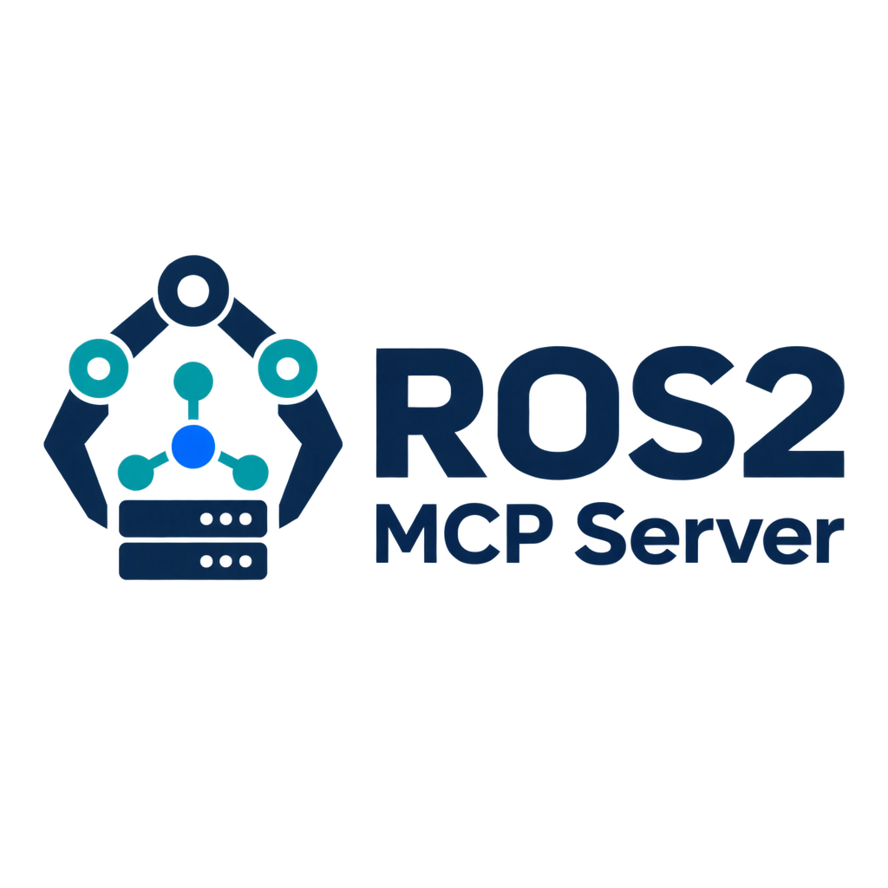

# ROS2 MCP Server

A Model Context Protocol (MCP) server that provides AI assistants with tools to introspect and interact with ROS2 robotics systems. This server enables Large Language Models (LLMs) and other AI systems to understand, monitor, and analyze ROS2 robot systems in real-time.

**This project is based on Marc Hanheide's implementation
([LCAS/ros2_mcp](https://github.com/LCAS/ros2_mcp)), which we have adapted to
work with ROS 2 Humble and MCP SDK v2.**



## Overview

The ROS2 MCP Server bridges the gap between AI assistants and robotics systems by exposing ROS2 functionality through the Model Context Protocol. It provides tools for topic monitoring, sensor data collection, system introspection, and real-time robot state analysis.

## Features

### Core Capabilities
- **Topic Monitoring**: Echo messages from any ROS2 topic with configurable message counts and timeouts
- **Image Processing**: Direct image retrieval from ROS2 Image topics for VLM (Vision Language Model) analysis
- **System Introspection**: List all available topics, nodes, and message types
- **Interface Analysis**: Detailed inspection of ROS2 message/service/action interfaces
- **Real-time Status**: Live system health monitoring and status reporting

### AI-Friendly Design
- **Structured Prompts**: Pre-built prompts for common robotics analysis tasks
- **Resource Streaming**: Live system status via MCP resources
- **VLM Integration**: Direct image data provision for computer vision analysis
- **Error Handling**: Robust error reporting and fallback mechanisms

## Installation

### Prerequisites
- ROS2 (Humble, Iron, or Jazzy)
- Python 3.11+
- OpenCV (`cv_bridge` package)

The MCP SDK v2 requires Python 3.11 or newer. Ensure the Python version used to
build this package is compatible with the Python version used by your ROS 2
installation. Standard Humble and Iron installations use Python 3.10 and need
a ROS build compiled for Python 3.11 or newer; Jazzy uses a compatible Python
version.

### using in your ROS2 workspace

To use this module in your ROS2 workspace, follow these steps:

1. **Clone the repository** into your ROS2 workspace's `src` directory:
    ```bash
    cd ~/your_ros2_workspace/src
    git clone <repository-url>
    ```


2. For easier deployment with the SSE interface exposed on port 8000:

```bash
export ROS_DOMAIN_ID=<your domain id>

# Start the MCP server with Docker Compose
docker compose up --build

# View logs
docker compose logs -f ros2-mcp-server

# Stop the service
docker compose down
```

#### Configuration

The Docker Compose setup can be configured via environment variables in the `.env` file:

- `DOCKER_REPO`: Docker repository name (default: `ros2-mcp`)
- `TAG`: Image tag to use (default: `latest`)
- `ROS_DOMAIN_ID`: ROS2 domain ID (default: `0`)
- `MCP_HOST`: Host to bind the MCP server (default: `0.0.0.0`)
- `MCP_PORT`: Port for the SSE interface (default: `8000`)

## Using the SSE Endpoint with an LLM

Once running, the MCP server's SSE interface will be available at:
- **Local**: `http://localhost:8000/sse`
- **Health check**: `http://localhost:8000/health`

### Expose to e.g. Claude

To expose the MCP server to external AI assistants like Claude, the simplest is to use `mcp-proxy` to expose the SSE endpoint directly as an STDIO MCP server (see https://github.com/sparfenyuk/mcp-proxy?tab=readme-ov-file#12-example-usage):


Example for Claude Desktop:

```json
{
  "mcpServers": {
    "mcp-proxy": {
      "command": "uv",
      "args": [
        "tool",
        "run",
        "mcp-proxy",
        "http://localhost:8000/sse"
      ]
    }
  }
}
```
